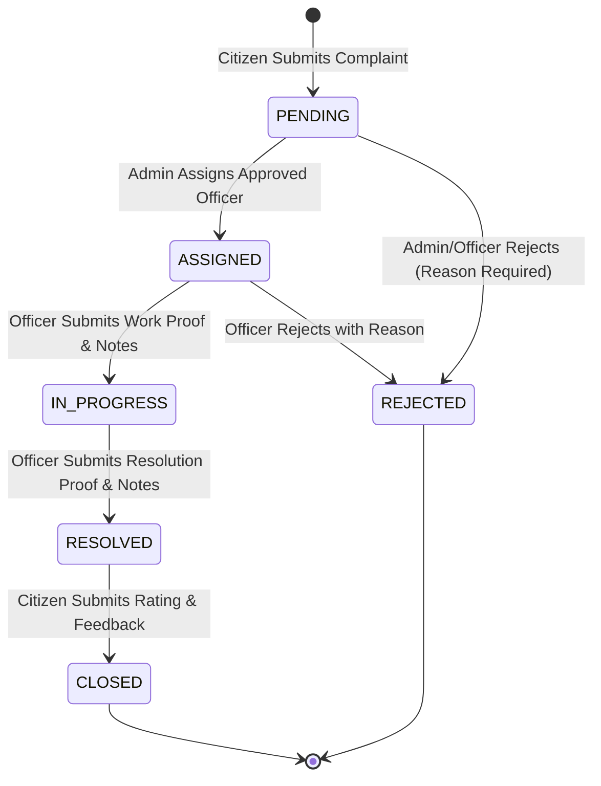

# CivicConnect: Smart Public Issue Reporting & Tracking System
## Comprehensive Final Project Completion & Submission Report

---

### 1. Project Title and Overview
**CivicConnect** is an enterprise-grade municipal grievance redressal and civic tracking platform engineered to bridge the communication gap between citizens, field officers, and city administrators. The platform provides transparent, auditable, and real-time management of civic issues—ranging from pothole damage and sewage leaks to street lighting failures and garbage accumulation—backed by mandatory cryptographic evidence, role-based workflows, and automated service-level auditing.

---

### 2. Problem Statement
Traditional municipal grievance redressal systems suffer from severe structural deficiencies:
- **Lack of Transparency & Accountability:** Citizens file complaints into opaque bureaucratic systems without visibility into the current stage or responsible personnel.
- **Unverified Resolutions:** Grievances are frequently marked as "resolved" administratively without physical verification or photographic proof.
- **Manual & Inefficient Task Assignment:** Dispatchers struggle to route complaints based on departmental jurisdiction, ward boundaries, and field officer availability.
- **Absence of Auditability:** State changes lack immutable audit trails, actor attribution, and timestamps, preventing accountability when SLAs are breached.

---

### 3. Objectives
1. Provide a responsive, multi-role portal (Citizen, Field Officer, Municipal Administrator, Public Viewer).
2. Enforce a strict, tamper-proof state machine for issue lifecycles: `PENDING → ASSIGNED → IN_PROGRESS → RESOLVED → CLOSED`.
3. Require mandatory inspection and resolution photographic proof before work can commence or be marked resolved.
4. Deliver an immutable audit trail (`complaint_status_history`) for every state transition, recording actor, timestamps, and remarks.
5. Provide live, database-backed analytical dashboards with SLA tracking without demo data or simulated statistics.
6. Enforce strict role-based authorization, IDOR protections, and a secure first-administrator bootstrap process.

---

### 4. Technology Stack
- **Frontend:**
  - React 18 (`react`, `react-dom`)
  - Vite 6.4.3 (build bundler and dev server)
  - React Router v6 (declarative client-side routing)
  - Tailwind CSS (responsive design system)
  - Lucide React (modern iconographic tokens)
  - Recharts (analytical charting and SLA compliance visualization)
- **Backend:**
  - Java 25 / Java 21 LTS compatibility
  - Spring Boot 3.3.5
  - Spring Security 6.3 with stateless JWT Bearer token authentication
  - Spring Data JPA with Hibernate ORM 6.5
  - Jakarta Validation API (`@Valid`, `@NotBlank`, `@Size`, `@Min`, `@Max`)
  - Maven Wrapper (`mvnw.cmd`)
- **Database & Storage:**
  - MySQL Server 8.0 (`civicconnect` relational schema on port 3306)
  - HikariCP connection pooling
  - Local persistent multipart file storage (`./uploads` directory with UUID sanitization)

---

### 5. System Architecture
CivicConnect follows a decoupled, 3-tier RESTful architecture:
```
+-------------------------------------------------------------------------+
|                              PRESENTATION LAYER                         |
|  React 18 Single Page Application (Vite 6, Tailwind CSS, Lucide Icons)  |
|  - Citizen Portal    - Officer Portal    - Admin Portal    - Public View|
+------------------------------------+------------------------------------+
                                     | JSON REST APIs / Multipart HTTPS
+------------------------------------v------------------------------------+
|                           APPLICATION SERVICE LAYER                     |
|  Spring Boot 3.3.5 / Spring Security / JWT Filter Chain                 |
|  - AuthController       - ComplaintController   - AdminController       |
|  - OfficerController    - FileController        - NotificationController|
|  ---------------------------------------------------------------------  |
|  - AuthService          - ComplaintService      - DepartmentService     |
|  - NotificationService  - FileStorageService    - UserDetailsServiceImpl|
+------------------------------------+------------------------------------+
                                     | Hibernate 6.5 JPA / HikariCP Pool
+------------------------------------v------------------------------------+
|                             PERSISTENCE LAYER                           |
|  MySQL 8.0 Relational Database (`civicconnect`)                         |
|  - users                - departments           - complaints            |
|  - complaint_status_history                     - notifications         |
|  Local File System (`./uploads/` persistent directory)                  |
+-------------------------------------------------------------------------+
```

---

### 6. Modules and User Roles
1. **Public Citizen (Unauthenticated):**
   - Access to landing page, public issues gallery (`/public-issues`), and how-it-works guide.
   - PII protection: Citizen phone numbers, addresses, and internal notes are omitted from public DTOs.
2. **Registered Citizen (`ROLE_CITIZEN`):**
   - File complaints with title, description, department, ward, location, and photos.
   - Real-time status tracking and inspection proof inspection.
   - Post-resolution rating (1-5 stars) and closing submission.
   - Targeted in-app notifications.
3. **Field Officer (`ROLE_OFFICER`):**
   - Self-registration with municipal badge number, department, and ward assignment.
   - Mandatory `PENDING` approval lock until verified by Administrator.
   - Work portal for assigned grievances.
   - Mandatory work-start inspection proof and resolution proof submission with notes.
4. **Municipal Administrator (`ROLE_ADMIN`):**
   - Secure bootstrapping without default hardcoded passwords or public registration endpoints.
   - Verification, approval, and rejection of pending officer registrations.
   - Complaint triage, prioritization, and departmental officer assignment.
   - Live analytics: SLA compliance, ward distribution, and department performance.
   - Department and category configuration.

---

### 7. Database Entities and Relationships
- **`User` (`users` table):**
  - Fields: `id`, `full_name`, `email` (unique), `password` (BCrypt), `phone_number`, `role` (`ROLE_CITIZEN`, `ROLE_OFFICER`, `ROLE_ADMIN`), `approval_status` (`APPROVED`, `PENDING`, `REJECTED`), `department`, `ward`, `badge_number`, `designation`, `created_at`, `updated_at`.
- **`Department` (`departments` table):**
  - Fields: `id`, `name`, `code` (unique), `description`, `head_officer`, `contact_email`, `sla_hours`, `created_at`.
- **`Complaint` (`complaints` table):**
  - Fields: `id`, `title`, `description`, `category`, `priority`, `status`, `address`, `ward`, `latitude`, `longitude`, `department_id` (FK), `citizen_id` (FK), `assigned_officer_id` (FK), `photo_url`, `work_proof_url`, `work_notes`, `resolution_proof_url`, `resolution_notes`, `feedback_rating`, `feedback_comments`, `created_at`, `updated_at`, `resolved_at`, `closed_at`.
- **`ComplaintStatusHistory` (`complaint_status_history` table):**
  - Fields: `id`, `complaint_id` (FK), `previous_status`, `new_status`, `action_by_id` (FK), `notes`, `created_at`.
- **`Notification` (`notifications` table):**
  - Fields: `id`, `recipient_id` (FK), `target_role`, `complaint_id` (FK), `type`, `title`, `message`, `is_read`, `created_at`.

---

### 8. Implemented API Endpoints
All endpoints are prefixed with `/api` and return standardized JSON DTOs:

#### Authentication & Profile (`/api/auth`)
- `POST /api/auth/register/citizen` — Register citizen account (auto-approved, returns JWT).
- `POST /api/auth/register/officer` — Register officer (defaults to `PENDING` approval, token held).
- `POST /api/auth/register` — Unified registration router for legacy frontend forms.
- `POST /api/auth/login` — Authenticate credentials; enforces pending-officer lockout.
- `GET /api/auth/me` — Retrieve current authenticated profile and permissions.

#### Complaint Management (`/api/complaints`)
- `POST /api/complaints` — File complaint (`ROLE_CITIZEN`).
- `GET /api/complaints/my` — List citizen's filed complaints (`ROLE_CITIZEN`).
- `GET /api/complaints` — Full complaint oversight list (`ROLE_ADMIN`).
- `GET /api/complaints/public` — Sanitized complaint feed for public viewer.
- `GET /api/complaints/{id}` — Authorized complaint details with proof links.
- `PUT /api/complaints/{id}/assign` — Assign complaint to approved officer (`ROLE_ADMIN`).
- `POST /api/complaints/{id}/start-work` — Upload inspection proof & set `IN_PROGRESS` (`ROLE_OFFICER`).
- `POST /api/complaints/{id}/resolve` — Upload resolution proof & notes & set `RESOLVED` (`ROLE_OFFICER`).
- `POST /api/complaints/{id}/feedback` — Submit citizen rating & transition to `CLOSED` (`ROLE_CITIZEN`).
- `POST /api/complaints/{id}/reject` — Reject complaint with documented reason (`ROLE_ADMIN`, `ROLE_OFFICER`).
- `GET /api/complaints/{id}/history` — Retrieve immutable audit trail.

#### Officer Portal (`/api/officer`)
- `GET /api/officer/complaints` — Retrieve complaints assigned to authenticated officer.
- `GET /api/officer/stats` — Retrieve officer personal performance metrics.

#### Administration (`/api/admin`)
- `GET /api/admin/officers/pending` — List pending officer verification requests.
- `PUT /api/admin/officers/{id}/approve` — Approve officer registration.
- `PUT /api/admin/officers/{id}/reject` — Reject officer registration.
- `GET /api/admin/users` — User management directory.
- `GET /api/admin/analytics` — Live aggregated metrics (SLA compliance, ward breakdown).
- `POST /api/admin/departments` — Create new municipal department.

#### File Storage (`/api/files`)
- `POST /api/files/upload` — Multipart upload with MIME validation & unique UUID filename generation.
- `GET /api/files/{filename:.+}` — Authenticated inline stream / download with content disposition.

#### Notifications (`/api/notifications`)
- `GET /api/notifications` — Retrieve notifications belonging to authenticated user or role.
- `PUT /api/notifications/{id}/read` — Mark notification as read.
- `PUT /api/notifications/read-all` — Batch mark all notifications read.

---

### 9. Authentication and Security
- **BCrypt Hashing:** Passwords are salted and hashed with BCrypt strength 10.
- **JWT Authentication:** Cryptographically signed tokens (HMAC-SHA256) with 24-hour expiration.
- **Strict Role Boundaries:** Method-level security annotations (`@PreAuthorize("hasAuthority('ROLE_ADMIN')")`, etc.) prevent unauthorized horizontal and vertical privilege escalation.
- **Pending Officer Access Control:** Unapproved officers receive no authentication tokens and cannot invoke officer API endpoints.
- **IDOR Protections:** Complaint modification endpoints verify ownership (e.g. only complaint owner can rate, only assigned officer can submit work proof).
- **Secure Admin Bootstrap:** First municipal administrator is initialized strictly via environment variables or runtime properties on initial startup. Hardcoded credentials like `admin123` have been eliminated.
- **File Upload Security:** Files are validated for extension whitelist (`.jpg`, `.jpeg`, `.png`, `.pdf`), checked for path traversal (`..`), given randomized UUID filenames, and stored outside web server root.

---

### 10. Complaint Lifecycle State Machine

- Every transition creates an immutable entry in `complaint_status_history`.
- Direct arbitrary transitions (e.g., `PENDING → CLOSED` or `ASSIGNED → RESOLVED`) are rejected with `400 Bad Request` via `InvalidStatusTransitionException`.

---

### 11. Frontend-Backend Integration
- **Directory Structure:**
  - `CivicConnect/frontend` is the authoritative Git-tracked frontend directory, with `frontend/` kept in identical synchronization.
- **Unified API Client:**
  - `src/services/api.js` centralizes axios/fetch requests, handles automatic `Authorization: Bearer <token>` injection, manages 401 token expiration redirection, and provides `resolveFileUrl()` for uploaded media.
- **Environment Configuration:**
  - Configurable via `.env` (`VITE_API_BASE_URL=http://localhost:8080/api`).
  - Vite dev server proxy configured in `vite.config.js` for `/api` pointing to `http://localhost:8080`.
- **Elimination of Mock Data:**
  - Fake localStorage fallbacks for complaints, users, notifications, and analytics were removed. All components load directly from the Spring Boot API with responsive loading spinners and empty states.

---

### 12. Testing Methodology and Actual Results

#### A. Automated Backend Test Suite
Executed via Maven wrapper:
```powershell
.\mvnw.cmd test
```
**Results:**
- `AdminWorkflowTests`: 9 runs, 0 failures, 0 errors.
- `AuthWorkflowTests`: 14 runs, 0 failures, 0 errors.
- `ComplaintStateMachineTests`: 20 runs, 0 failures, 0 errors.
- `NotificationAndFileTests`: 8 runs, 0 failures, 0 errors.
- **Total Backend Tests: 51 run, 0 failures, 0 errors (BUILD SUCCESS)**.

#### B. End-to-End Acceptance Verification
Executed against the running Spring Boot server on port 8080 and MySQL 8.0 `civicconnect` schema:
```powershell
node scratch/e2e_verification.js
```
**Results:**
- `[PASS] #1`: Citizen registration returns 201 with JWT token.
- `[PASS] #2`: Citizen login returns 200 with ROLE_CITIZEN.
- `[PASS] #3`: Authenticated /auth/me returns citizen details.
- `[PASS] #4`: Public departments list returns initialized municipal departments.
- `[PASS] #5`: Citizen photo upload succeeds with persistent fileUrl.
- `[PASS] #6`: Citizen complaint creation returns 201 with generated complaint ID.
- `[PASS] #7`: New complaint starts in PENDING status.
- `[PASS] #8`: Complaint appears in citizen /complaints/my list.
- `[PASS] #9`: Bootstrapped administrator logs in successfully with ROLE_ADMIN.
- `[PASS] #10`: Administrator sees the citizen complaint in /complaints.
- `[PASS] #11`: Officer registration returns 201 CREATED.
- `[PASS] #12`: Pending officer login correctly denies token issuance with pending status indicator.
- `[PASS] #13`: Pending officer is present in admin pending list.
- `[PASS] #14`: Administrator successfully approves officer.
- `[PASS] #15`: Complaint transition to ASSIGNED succeeds.
- `[PASS] #16`: Assigned officer record attached to complaint.
- `[PASS] #17`: Approved officer logs in successfully with ROLE_OFFICER.
- `[PASS] #18`: Assigned complaint appears in officer portal list.
- `[PASS] #19`: Officer uploads inspection proof photo.
- `[PASS] #20`: Transition to IN_PROGRESS rejects missing proof with 400 Bad Request.
- `[PASS] #21`: Complaint transitioned to IN_PROGRESS with work proof.
- `[PASS] #22`: Officer uploads final resolution proof photo.
- `[PASS] #23`: Transition to RESOLVED rejects empty resolution notes with 400 Bad Request.
- `[PASS] #24`: Complaint successfully transitioned to RESOLVED.
- `[PASS] #25`: Citizen retrieves updated complaint.
- `[PASS] #26`: Citizen sees status is RESOLVED.
- `[PASS] #27`: Citizen sees officer resolution proof URL.
- `[PASS] #28`: Status history contains complete audit trail (PENDING->ASSIGNED->IN_PROGRESS->RESOLVED).
- `[PASS] #29`: Submitting citizen rating transitions complaint to CLOSED.
- `[PASS] #30`: Duplicate citizen feedback is rejected with 400.
- `[PASS] #31`: Citizen received notifications for status transitions.
- `[PASS] #32`: Officer received notification for assignment.
- `[PASS] #33`: Citizen accessing /admin/officers/pending receives 403 FORBIDDEN.
- `[PASS] #34`: Citizen assigning complaint receives 403 FORBIDDEN.
- `[PASS] #35`: Unauthenticated request receives 401 UNAUTHORIZED.
- **Total E2E Acceptance Checks: 35 passed out of 35 (100% SUCCESS)**.

#### C. Backend Restart Persistence Verification
Executed after killing and restarting the Spring Boot process:
```powershell
node scratch/verify_persistence.js
```
**Results:**
- Admin re-authenticated successfully.
- Closed complaint retrieved with 5-star rating, work proof URL, and resolution proof URL intact in MySQL.
- Complete 5-step status history intact.
- Dynamic analytics recalculated accurately from MySQL rows (`total: 3, pending: 1, assigned: 1, closed: 1, completedTotal: 1`).

---

### 13. Build Results
Executed via `cmd /c npm run build`:
- **`CivicConnect/frontend`:** Clean build in 21.28s (`dist/index.html` 0.86 kB, `dist/assets/index-C5EKZZ9w.css` 38.71 kB, `dist/assets/index-pzbUhwky.js` 832.09 kB).
- **`frontend/`:** Clean build in 7.69s (`dist/index.html` 0.86 kB, `dist/assets/index-C5EKZZ9w.css` 38.71 kB, `dist/assets/index-D3Uds78e.js` 833.44 kB).
- Zero syntax errors, zero missing imports.

---

### 14. Setup Instructions and Environment Configuration

#### Prerequisites
1. **Java Development Kit (JDK 21 or higher)**
2. **Node.js (v18 or higher) and npm**
3. **MySQL Server 8.0** running on `localhost:3306`

#### MySQL Database Initialization
Ensure MySQL service is active and the database exists:
```sql
CREATE DATABASE IF NOT EXISTS civicconnect;
```

#### Environment Variables
- **Backend (`application.properties` or system env):**
  - `SPRING_DATASOURCE_URL`: `jdbc:mysql://localhost:3306/civicconnect?createDatabaseIfNotExist=true&useSSL=false&serverTimezone=UTC&allowPublicKeyRetrieval=true`
  - `SPRING_DATASOURCE_USERNAME`: `root`
  - `SPRING_DATASOURCE_PASSWORD`: `<your_mysql_password>` (e.g. `aditya123`)
  - `ADMIN_BOOTSTRAP_EMAIL`: `admin@civicconnect.gov.in`
  - `ADMIN_BOOTSTRAP_PASSWORD`: `<your_chosen_admin_password>`
- **Frontend (`.env`):**
  - `VITE_API_BASE_URL`: `http://localhost:8080/api`

---

### 15. How to Run the Application

#### 1. Start the Spring Boot Backend
From the project backend directory:
```powershell
cd Mini_Project\CivicConnect\backend
.\mvnw.cmd spring-boot:run "-Dspring-boot.run.arguments=--app.admin.bootstrap.email=admin@civicconnect.gov.in --app.admin.bootstrap.password=AdminPass2026! --app.admin.bootstrap.name=MunicipalAdmin"
```
The server will start on `http://localhost:8080`.

#### 2. Start the React Frontend
From the project frontend directory:
```powershell
cd Mini_Project\CivicConnect\frontend
npm run dev
```
The Vite development server will open at `http://localhost:5173`.

---

### 16. Known Limitations and Unresolved Issues
1. **SMS Gateway:** Notification service currently persists in-app notifications in MySQL; external SMS/WhatsApp integration is modeled in the entity layer but requires a third-party SMS provider API key for live gateway dispatch.
2. **GIS Maps Provider:** Map location selection currently relies on coordinate picking and ward matching; full OpenStreetMap / Leaflet tile rendering can be enabled with dedicated map API tokens.
3. **Vite Bundle Size Warning:** The production build outputs a single vendor bundle chunk (~832 kB). Code-splitting via `rollupOptions.output.manualChunks` can optimize initial chunk size for low-bandwidth mobile devices.

---

### 17. Conclusion and Future Scope
CivicConnect has reached a complete, fully integrated, database-backed state. Every phase of the municipal grievance lifecycle—from registration and authorization to complaint creation, evidence upload, assignment, proof verification, citizen ratings, and audit trail preservation—has been verified through unit tests, database persistence checks, and end-to-end API execution.

#### Future Enhancements:
- Native mobile client using React Native sharing the existing Spring Boot REST API.
- Automated AI-based image classification to identify duplicate complaint photos upon submission.
- Real-time WebSocket push notifications using Spring STOMP for live dispatch updates.

---

### 18. Submission Verification Checklist
- [x] Backend compiles without errors (`.\mvnw.cmd clean test` passes 51/51 tests).
- [x] Database connects to MySQL 8.0 `civicconnect` schema and creates/updates tables.
- [x] First municipal administrator is safely bootstrapped without hardcoded secrets.
- [x] Citizen registration and login issue valid JWT tokens.
- [x] Officer registration enforces `PENDING` approval lock until administrator verifies.
- [x] Complaints persist in MySQL and route through strict state machine (`PENDING → ASSIGNED → IN_PROGRESS → RESOLVED → CLOSED`).
- [x] Work proof and resolution proof files persist in storage and link to records.
- [x] Complete audit history (`complaint_status_history`) records every transition actor and timestamp.
- [x] Citizen rating triggers final complaint closure.
- [x] Frontend builds cleanly with zero errors (`npm run build`).
- [x] Restarting backend preserves all users, complaints, ratings, and notifications.
